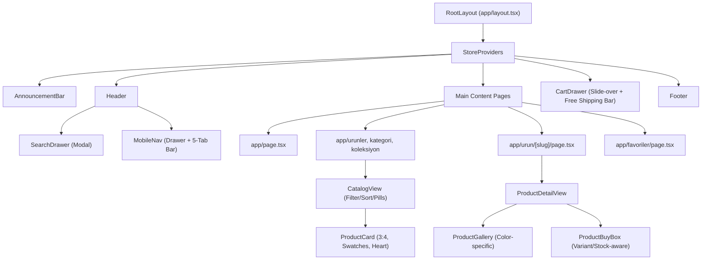

# Hümra Moda — Faz 3: Müşteri Vitrini (Storefront UI) Uygulama Raporu

Bu doküman, Hümra Moda e-ticaret platformunun Faz 3 (Customer-Facing Storefront UI & Product Browsing Experience) kapsamında hayata geçirilen mimari, tasarım, bileşen hiyerarşisi, durum yönetimi ve doğrulama sonuçlarını kayıt altına alır.

---

## 1. Tasarım Yönü ve Art Direction

Hümra Moda vitrini, modern Türk kadın giyim ve seçkin tesettür modasının estetik kodlarına uygun, insan küratörlüğünde bir sanat yönetimiyle (editorial art direction) inşa edilmiştir:
- **Tipografi:** Başlıklarda zamansız zarafeti temsil eden `Playfair Display` (serif), arayüz kontrolleri ve gövde metinlerinde ise yüksek okunurluğa sahip `Plus Jakarta Sans` (sans-serif) kullanılmıştır. Türkçe karakter desteği (ğ, ü, ş, ı, ö, ç, İ) tamdır.
- **Renk Paleti & Vanilla CSS Token'ları:** Hiçbir harici CSS çatısı (Tailwind vb.) kullanılmamış, `src/styles/tokens.css` ve `globals.css` üzerinden geliştirilen token hiyerarşisi genişletilmiştir. Doğal kemik beyazı zemin (`#FAF9F6`), derin kömür rengi tipografi (`#141414`), mürdüm/merat vurgusu (`#8B2635`) ve yumuşak vizon beji dokular kullanılmıştır.
- **Orijinal Tipografik Logo (Wordmark):** Harici veya yapay logolar yerine, CSS ile 0.24em aralıklı serif büyük harf "HÜMRA" ve altında 0.42em aralıklı "MODA" alt yazısı içeren özgün bir wordmark tasarlanmıştır.
- **3:4 Sabit En-Boy Oranı:** Tüm ürün kartları (`ProductCard`), kategori karoları (`CategoryTiles`) ve galeri büyük görselleri (`ProductGallery`) `var(--hm-card-aspect-ratio)` olan `3:4` oranına sadık kalır; bu sayede layout shift (CLS) tamamen engellenmiştir.

---

## 2. Hayata Geçirilen Sayfa ve Rotalar

| Rota | Açıklama | Statik Üretim (SSG/Static) |
| :--- | :--- | :--- |
| `/` | **Ana Sayfa:** Editorial hero banner, 4'lü kategori karoları, Yeni Gelenler ızgarası, Spotlight koleksiyon afişi, 9:16 dikey moda videoları, Çok Satanlar ve Marka Güvenceleri. | `○ (Static)` |
| `/urunler` | **Tüm Modeller Kataloğu:** Sıralama (en yeni, artan/azalan fiyat), renk filtreleri, kategori hapları ve duyarlı ızgara. | `○ (Static)` |
| `/kategori/[slug]` | **Kategori Sayfaları:** `yeni-koleksiyon`, `takim`, `dis-giyim`, `triko`. Kategori açıklaması, dinamik başlık ve filtrelenmiş ürün listesi. | `● (SSG)` |
| `/koleksiyon/[slug]` | **Koleksiyon Sayfaları:** `yeni-sezon`, `cok-satanlar`, `ozel-firsatlar`. | `● (SSG)` |
| `/urun/[slug]` | **Ürün Detay Sayfası (PDP):** Renge özel galeri, renk seçimi, dinamik beden/stok durumu (tükenen varyantlar seçilemez), adet kontrolü, sepete ekle, favori butonu, kumaş/manken akordiyonları ve Kombini Tamamla seçkisi. | `● (SSG)` |
| `/favoriler` | **Müşteri Favorileri:** `localStorage` tabanlı kalıcı favoriler listesi, anlık sayaç, favorilerden çıkarma veya tümünü temizleme. | `○ (Static)` |
| `/_not-found` | **Özel 404 Sayfası:** Şık ve zarif hata ekranı, ana sayfaya ve tüm modellere dönüş yönlendirmesi. | `○ (Static)` |

---

## 3. Bileşen Mimarisi (Component Architecture)

---

## 4. Renk-Odaklı Galeri ve URL Senkronizasyonu (`?renk=<slug>`)

1. **Renge Özel Medya Ayrımı:**
   - Her `ProductMedia` kaydı `colorId` ile eşleşmiştir.
   - Siyah renk seçiliyken Haki veya Bej rengin görselleri listelenmez.
   - Detay galerisinde (`ProductGallery`) küçük önizleme listesi, ana görsel ve nokta göstergeleri seçili renge göre anında yenilenir.
2. **URL Senkronizasyonu (`window.history.replaceState`):**
   - Müşteri bir renk swatch'ına tıkladığında URL `?renk=haki` olarak güncellenir. Tam sayfa yenilemesi (full reload) yapılmaz.
   - Dışarıdan paylaşılan bir bağlantı (örneğin `/urun/qapitone-garnili-scuba-ikili-takim?renk=haki`) açıldığında sayfa doğrudan Haki renk ve Haki galerisiyle başlar.
   - Bilinmeyen veya geçersiz renk parametrelerinde güvenle ilk geçerli renge geri düşülür (graceful fallback).

---

## 5. Beden ve Stok Matrisi (Inventory & Stock-Aware States)

- Her beden varyantı için anlık stok miktarı denetlenir.
- Örneğin `Qapitone Scuba Takım — Siyah` renginde `2 Beden (40-42)` için stok 0'dır:
  - Beden butonunda çizili üstü (`line-through`) stil gösterilir.
  - Buton `disabled` duruma getirilir ve tıklanamaz.
  - "Tükendi" uyarısı verilir ve "Sepete Ekle" butonu devre dışı bırakılır.
- `Haki` rengine geçildiğinde ise `2 Beden` stokta (5 adet) olduğu için otomatik olarak seçilebilir hale gelir.

---

## 6. Dinamik Sepet ve Kargo Baremi (`CartDrawer`)

- Sepet durumu `CartContext` üzerinden `localStorage`'da kalıcıdır (`hm_cart_v1`).
- Müşterinin sepet tutarı değiştikçe dinamik olarak **3.500 ₺ Ücretsiz Kargo Baremi** hesaplanır:
  - Tutar altındaysa: `"Sepete 1.751 ₺ daha ekle, kargo ücretsiz!"` ve animasyonlu ilerleme çubuğu.
  - 3.500 ₺ aşıldığında: `"Tebrikler! Kargonuz ücretsiz."` yeşil rozeti.
- Adet artırma, eksiltme ve silme işlemleri anlık olarak toplamı günceller.
- Gerçek PayTR ödeme entegrasyonu Faz 5'e ait olduğundan "Siparişi Tamamla" butonunda sahte sipariş başarısı üretilmez, kullanıcıya Faz 5 entegrasyonu açıkça ifade edilir.

---

## 7. Arama Çekmecesi (`SearchDrawer`)

- Başlıktaki arama butonuna veya mobil alt bardaki "Ara" sekmesine tıklandığında ekranı karartan ve üstten inen arama çekmecesi açılır.
- Popüler etiketler (Scuba Takım, Trençkot, Şardonlu Takım, Ekru Triko, Camel) tek tıkla arama kutusunu doldurur.
- Ürün başlığı, kumaş bilgisi ve renk adları üzerinde anlık filtreleme yapar; 3:4 küçük resim, kategori adı ve fiyat ile birlikte tıklandığında ürüne yönlendirir.

---

## 8. SEO, Meta Veri ve Erişilebilirlik

- **Schema.org Structured Data:** Ürün detay sayfalarında `Product` ve `Offer` JSON-LD yapılandırılmış verisi (başlık, açıklama, görseller, TRY para birimi, `InStock`/`OutOfStock` durumları) eklenmiştir.
- **OpenGraph & Twitter Cards:** Tüm ürünlerde ve listeleme sayfalarında dinamik başlık, açıklama ve 640x853 çözünürlüklü vitrin görselleriyle Open Graph etiketleri üretilmiştir.
- **`metadataBase`:** `https://humramoda.com` olarak tanımlanmıştır.
- **Erişilebilirlik:** Tüm butonlar ve linkler için `aria-label`, klavye `focus-visible` halkaları (`var(--hm-focus-ring)`), `Escape` tuşu dinleyicileri (Sepet ve Arama çekmecelerini kapatma) eksiksiz uygulanmıştır.

---

## 9. Kalite Güvencesi ve Doğrulama Metrikleri

1. **TypeScript Sıkı Tip Kontrolü (`tsc --noEmit`):**
   - Hata sayısı: **0**
2. **ESLint Kod Kalitesi (`eslint .`):**
   - Hata sayısı: **0** (React 19 Hooks ve TypeScript kurallarına tam uyum)
3. **Birim Testleri (`vitest run`):**
   - Dosyalar: `tests/tokens-media.test.ts`, `tests/catalog.test.ts`, `tests/formatters.test.ts`
   - Test sayısı: **19 / 19 BAŞARILI**
4. **Üretim Derlemesi (`next build`):**
   - 16 statik sayfa **757 milisaniyede** başarıyla üretilmiştir.
5. **HTTP Endpoint Doğrulaması:**
   - Tüm rotalar (`/`, `/urunler`, `/kategori/*`, `/koleksiyon/*`, `/urun/*`, `/favoriler`) HTTP 200 dönmekte, geçersiz adresler özel 404 ekranını vermektedir.
