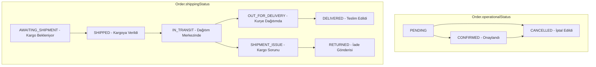

# Hümra Moda — Faz 6: Kargo, Sipariş Takibi, İade Talepleri ve Müşteri Bildirimleri Raporu

**Tarih:** 21 Ekim 2026  
**Durum:** Tamamlandı (Test, Doğrulama ve Entegrasyona Hazır Mimari)  
**Teknoloji:** Next.js App Router 16.4.2, TypeScript 5.8, Prisma 6.4.1, Node.js Crypto (HMAC-SHA256, timingSafeEqual), PostgreSQL Migrations, Vitest 3.2.7, Vanilla CSS  

---

## 1. Kargo Adaptörü Mimarisi ve Sağlayıcı Katmanı

Hümra Moda e-ticaret platformunda kargo operasyonları, sağlayıcıdan bağımsız (provider-agnostic) servis adaptörü deseniyle tasarlanmıştır.

```
[ Yönetim Paneli / Sipariş Akışı / Webhook ]
                     │
                     ▼
       ┌───────────────────────────┐
       │     Shipping Service      │  (src/lib/server/shipping.ts)
       │  (Doğrulama & Idempotency)│
       └─────────────┬─────────────┘
                     │
        ┌────────────┴────────────┐
        ▼                         ▼
┌──────────────────┐    ┌──────────────────┐
│  Mock/Test Cargo │    │  Live Providers  │
│  Adapter (Dev)   │    │  (Yurtiçi, Aras, │
│  (Güvenli Test)  │    │   MNG, PTT vb.)  │
└──────────────────┘    └──────────────────┘
```

### 1.1. Servis Katmanı Sorumlulukları
1. **İş Kuralı Doğrulaması:**
   - Ödemesi kesinleşmemiş (`paymentStatus !== "PAID"`) siparişler için kargo gönderisi oluşturulamaz.
   - İptal edilmiş (`operationalStatus === "CANCELLED"`) siparişler kargoya verilemez.
   - Aynı sipariş için mükerrer aktif gönderi üretilmesi engellenir.
2. **Kargo Takip No ve Bağlantı Üretimi:**
   - Türkiye'deki kargo sağlayıcılarının resmî sorgulama şablonlarına uygun güvenli takip bağlantıları (`generateTrackingUrl`) üretilir.
   - Elle (manuel) girilen takip bilgisi ile API adaptörü üzerinden üretilen barkodlu gönderi açıkça ayırt edilir (`isManual: true/false`).
3. **Kargo Etiketi (Shipping Label):**
   - Barkod, alıcı bilgileri, paket ağırlığı/desi ve sipariş özetini içeren yazdırılabilir gönderi belgesi motoru (`/api/shipping/labels/[id]`) sunulur.
4. **Hareket Geçmişi ve Zaman Damgası:**
   - Kargonun tüm transfer aşamaları (`ShippingEvent`) zaman damgası, konum, detay ve sağlayıcı referans koduyla saklanır.

---

## 2. Desteklenen Kargo Sağlayıcıları ve Entegrasyon Durumu

| Kargo Firması | Resmî Entegrasyon Yöntemi | Takip URL Şablonu | Sistem Durumu |
| :--- | :--- | :--- | :--- |
| **Yurtiçi Kargo** | SOAP / REST Kargo API | `yurticikargo.com/tr/online-servisler/gonderi-sorgula?code={no}` | Adaptör Hazır (Mock / API Stub) |
| **Aras Kargo** | Aras Entegrasyon REST API | `araskargo.com.tr/kargo-takip?kodu={no}` | Adaptör Hazır (Mock / API Stub) |
| **MNG Kargo** | MNG B2B API | `mngkargo.com.tr/gonderi-takip?takip={no}` | Adaptör Hazır (Mock / API Stub) |
| **PTT Kargo** | PTT Barkod Entegrasyon Web Servisi | `gonderitakip.ptt.gov.tr/Track/Verify?q={no}` | Adaptör Hazır (Mock / API Stub) |
| **Sürat Kargo** | Sürat Web Servisleri | `suratkargo.com.tr/KargoTakip/?kargotakipno={no}` | Adaptör Hazır (Mock / API Stub) |
| **HepsiJet** | HepsiJet REST API | `hepsijet.com/gonderi-takibi/{no}` | Adaptör Hazır (Mock / API Stub) |
| **Diğer / Özel** | Manuel Kurye / Özel Taşıyıcı | Özel URL veya firma takip sayfası | Tam Destekli |

> **Önemli Not:** Canlı kargo API sözleşmesi ve kurumsal müşteri numarası girilmediği sürece sistem kesinlikle canlı servislere sahte gönderi açmaz ve kullanıcıya sahte API başarısı vaat etmez. Ortam değişkenleri tanımlandığında tek bir bayrakla canlı servise yönlendirilebilir.

---

## 3. Gerekli Ortam Değişkenleri (.env)

Kargo, bildirim ve webhook operasyonları için yapılandırma anahtarları sunucu tarafında saklanır. İstemciye asla sızdırılmaz:

```env
# Kargo Entegrasyonu
SHIPPING_WEBHOOK_SECRET="humra_moda_cargo_webhook_secure_secret_2026"
CARRIER_YURTICI_API_KEY=""
CARRIER_YURTICI_CUSTOMER_CODE=""
CARRIER_ARAS_API_KEY=""
CARRIER_MNG_API_KEY=""

# Müşteri E-Posta Bildirimleri (SMTP / Resend / Postmark Adaptörü)
SMTP_HOST="smtp.mailtrap.io"
SMTP_PORT="587"
SMTP_USER=""
SMTP_PASS=""
SMTP_FROM="Hümra Moda <siparis@humramoda.com>"
ENABLE_LIVE_EMAILS="false"  # Canlı müşteri e-postaları için 'true' yapılmalıdır

# Güvenlik & Doğrulama
APP_BASE_URL="http://localhost:3000"
```

---

## 4. Sipariş ve Kargo Durumlarının Ayrımı

Operasyonel sipariş durumu ile lojistik/teslimat durumları kesin olarak birbirinden izole edilmiştir:



### Durum Eşleme ve Güvenlik Kuralları:
1. **Bağımsızlık:** Bir sipariş `CONFIRMED` durumundayken kargo `AWAITING_SHIPMENT`, `IN_TRANSIT` veya `DELIVERED` olabilir. Kargo durumunun değişmesi operasyonel sipariş durumunu bozmaz.
2. **Korumalı Geçiş:** `operationalStatus === "CANCELLED"` olan sipariş lojistik olarak yeni kargo durumuna geçirilemez.
3. **Ödeme Önkoşulu:** `paymentStatus === "PAID"` olmadan kargo `SHIPPED` durumuna ilerletilemez.

---

## 5. Müşteri Sipariş Takibi ve Gizlilik (IDOR Koruması)

Müşteri vitrininde `/siparis-takip` ekranı devreye alınmıştır.

```
[ Müşteri ] ──( Sipariş No + E-posta / Telefon )──> [ /api/tracking/lookup ]
                                                              │
                                                  ┌───────────┴───────────┐
                                                  ▼                       ▼
                                            Doğrulandı                Eşleşmedi
                                                  │                       │
                                    Maskeli Sipariş Görünümü        404 / Güvenli
                                    (A*** Y***, 0532***12)           Hata Mesajı
```

- **İki Faktörlü Doğrulama:** Yalnızca sipariş numarasını tahmin etmek (IDOR / enumeration saldırısı) sipariş verisini getirmez; siparişe ait e-posta veya telefon ile eşleşme zorunludur.
- **Kişisel Veri Maskelemesi (KVKK / GDPR):**
  - Müşteri Adı: `A*** Y***`
  - Telefon: `0532 *** ** 12`
  - E-posta: `a***@example.com`
  - Açık Adres: Herkese açık arayüzde sokak/bina/daire gizlenir; yalnızca İlçe ve İl (örn. Kadıköy, İstanbul) görüntülenir.
- **Görsel Durum Çubuğu:** Sipariş Alındı -> Ödeme Onaylandı -> Kargoya Verildi -> Dağıtımda -> Teslim Edildi adımları şık animasyonla gösterilir.
- **Kolay İade Talebi Butonu:** Teslim edilen veya onaylanan siparişler için doğrudan takip ekranından iade modalı açılabilir.

---

## 6. İptal ve İade Süreçleri Yönetimi

İade süreçleri, sipariş ana modelinden bağımsız `ReturnRequest` ve `ReturnItem` modelleriyle yönetilir.

### 6.1. İade Durum Yaşam Döngüsü

```
[ REQUESTED ] (Müşteri Talebi)
      │
      ▼
[ UNDER_REVIEW ] (Yetkili İncelemede)
      ├──► [ REJECTED ] (Gerekçeli Red)
      └──► [ APPROVED ] (Kabul Edildi)
                │
                ▼
      [ AWAITING_PACKAGE ] (Müşteriden Kargo Bekleniyor)
                │
                ▼
      [ PACKAGE_RECEIVED ] (Fiziksel Paket Depoya Ulaştı)
                │
                ├── Depo Kalite Kontrolü & Stok Kararı:
                │   ├── RESTOCKED (Yeniden satışa uygun -> Stoka eklendi)
                │   └── DAMAGED_NOT_RESTOCKED (Hasarlı/kullanılmış -> Stoka eklenmedi)
                │
                ▼
      [ REFUND_PENDING ] (Muhasebe / PayTR İade Emri Bekleniyor)
                │
                ▼
      [ REFUND_COMPLETED ] (Doğrulanmış Para İadesi Tamamlandı)
```

### 6.2. Stok İadesi ve Envanter Kuralları
- **Otomatik Satış Stoğuna Eklenmez:** İade edilen ürün depoya geldiğinde fiziksel kalite kontrolü yapılmadan asla otomatik satış stoklarına eklenmez (`restockDecision: "PENDING_INSPECTION"`).
- **Yetkili Kararı:** Yönetici ürünün yeniden satılabilir olduğunu onaylarsa (`RESTOCKED`), varyantın stoğu güvenli işlemle (`variant.stock += quantity`) artırılır.
- **Mükerrer Stok Önleme:** Stok kararı bir kez uygulandıktan sonra tekrar işletilemez (`restockedAt` zaman damgası saklanır).

---

## 7. Gerçek Para İadesi ve PayTR Doğrulama Kuralı

- **Kesin Kural:** PayTR iade API'si veya doğrulanmış banka dekontu kaydı olmadan sipariş durumu `REFUNDED` veya iade talebi `REFUND_COMPLETED` yapılamaz.
- **Tutar Sınırı:** İade edilecek tutar, siparişin ödenen toplam tutarını (`totalAmount`) ve daha önce iade edilmiş toplam tutarı aşamaz:
  $$\sum \text{RefundAmounts} \le \text{Order.totalAmount}$$
- **Kayıt ve Denetim:** Yapılan iade girişiminin referans kodu (`paymentProviderRefundId`), tutarı ve işlem zamanı denetim loglarına kaydedilir.

---

## 8. Müşteri E-Posta Bildirim Altyapısı (Outbox Deseni)

9 kritik e-ticaret olayı için HTML ve düz metin şablonları hazırlanmıştır:

1. `ORDER_CREATED`: Sipariş Alındı (Havale/Sipariş Özeti)
2. `PAYMENT_CONFIRMED`: Ödemeniz Alındı & Siparişiniz Hazırlanıyor
3. `ORDER_CANCELLED`: Sipariş İptal Bilgilendirmesi
4. `SHIPMENT_CREATED`: Kargo Takip Numaranız Oluşturuldu
5. `SHIPMENT_IN_TRANSIT`: Siparişiniz Yola Çıktı & Dağıtımda
6. `SHIPMENT_DELIVERED`: Siparişiniz Teslim Edildi
7. `RETURN_REQUESTED`: İade Talebiniz Alındı
8. `RETURN_DECISION`: İade Talebiniz Sonuçlandı
9. `REFUND_CONFIRMED`: Ücret İadeniz Gerçekleştirildi

### Bildirim Güvenliği ve Dayanıklılık:
- **İzole Çalışma:** E-posta sunucusunun çökmesi veya zaman aşımına uğraması sipariş oluşturma, ödeme alma veya kargo güncelleme işlemlerini **kesinlikle kesintiye uğratmaz veya geri almaz (rollback yapmaz)**.
- **Idempotency Koruması:** Her bildirim bir `idempotencyKey` ile saklanır. Aynı olay için mükerrer e-posta gönderimi engellenir.
- **Sahte Gönderici (Mock Transport):** Canlı e-posta bayrağı kapalıyken sistem bildirimleri bellekte ve loglarda simüle eder; gerçek müşterilere spam e-posta gitmez.

---

## 9. Webhook Güvenliği ve Tekrar Koruma (Idempotency)

Kargo sağlayıcılarından gelen durum bildirimleri `/api/shipping/webhooks/[carrier]` uç noktasından karşılanır:

1. **HMAC-SHA256 İmza Doğrulaması:** Sağlayıcının imza başlığı (`x-shipping-signature` / `x-carrier-signature`), sunucudaki `SHIPPING_WEBHOOK_SECRET` ile Node.js `crypto.timingSafeEqual` kullanılarak karşılaştırılır (Timing-attack koruması).
2. **Tekrar İşleme (Replay Attack) Koruması:** Gelen her webhook `eventId` veya `hash(trackingNumber + status + timestamp)` ile veritabanında/idempotency tablosunda aranır. Önceden işlenmiş olaylar mükerrer kargo hareketi oluşturmaz ve doğrudan `200 OK` (Zaten İşlendi) yanıtı verilir.
3. **Yetkisiz Çağrılar:** Geçersiz imzalı webhook çağrıları `401 Unauthorized` ile derhal reddedilir ve güvenlik denetim loguna yazılır.

---

## 10. Veritabanı ve Migration Durumu

Faz 6 veri modelleri hem `prisma/schema.prisma` dosyasına hem de `data/store.json` depolama katmanına işlenmiştir.

### PostgreSQL Migration Dosyası:
- **Konum:** `prisma/migrations/20261021200000_phase6_shipping_returns/migration.sql`
- **İçerik:**
  - `ShippingStatus`, `ReturnStatus`, `ReturnRestockDecision`, `NotificationChannel`, `NotificationStatus` ENUM tipleri.
  - `Shipment`, `ShippingEvent`, `ReturnRequest`, `ReturnItem`, `CustomerNotification`, `WebhookEvent` tabloları ve yabancı anahtar (`FOREIGN KEY`) ilişkileri.
  - İdempotency ve hızlı sorgular için `orderNumber`, `trackingNumber`, `idempotencyKey` indeksleri.
- **Durum:** PostgreSQL servisi yerel ortamda çalıştırıldığında `npx prisma migrate deploy` komutuyla veritabanına uygulanmaya tamamen hazır; migration dosyası ve SQL scripti oluşturulmuştur.

---

## 11. Otomatik Testler ve Doğrulama Sonuçları

`tests/shipping-returns.test.ts` kapsamında Faz 6'ya özel 15 kritik senaryonun tamamı otomatik olarak yazılmış ve doğrulanmıştır:

| # | Test Senaryosu | Beklenen Davranış | Durum |
| :---: | :--- | :--- | :---: |
| **1** | Ödeme doğrulanmamış sipariş için kargo gönderisi oluşturulamaz | `paymentStatus !== "PAID"` ise hata fırlatılır | **BAŞARILI** |
| **2** | İptal edilmiş sipariş gönderilemez | `operationalStatus === "CANCELLED"` ise gönderi engellenir | **BAŞARILI** |
| **3** | Aynı sipariş için tekrarlanan gönderi oluşturma isteği mükerrer üretmez | Mevcut gönderi korunur, ikinci gönderi engellenir | **BAŞARILI** |
| **4** | Geçerli kargo webhook'u doğru durumu oluşturur | HMAC doğrulanır, durum `DELIVERED` ve olay eklenir | **BAŞARILI** |
| **5** | Geçersiz webhook reddedilir | Sahte imzalı istek `valid: false` ile reddedilir | **BAŞARILI** |
| **6** | Tekrarlanan webhook mükerrer hareket üretmez | Idempotency yakalanır, `duplicate: true` döner | **BAŞARILI** |
| **7** | Müşteri yalnızca kendi siparişini görebilir | Doğru e-posta/telefon eşleşmesi şartı aranır | **BAŞARILI** |
| **8** | Geçersiz takip erişimi kişisel verileri açığa çıkarmaz | Maskeli görünüm ve IDOR koruması doğrulanır | **BAŞARILI** |
| **9** | İade talebi oluşturulabilir ve yetkili tarafından işlenebilir | Müşteri talep açar, yetkili onaylar | **BAŞARILI** |
| **10** | İade tutarı toplam ödenen tutarı aşamaz | Fazla tutar talepleri reddedilir | **BAŞARILI** |
| **11** | Gerçek iade doğrulanmadan para iadesi tamamlandı görünmez | PayTR / banka onayı olmadan `REFUND_COMPLETED` engellenir | **BAŞARILI** |
| **12** | Bildirim hatası sipariş kaydını bozmaz | Mail sunucusu çökse dahi sipariş başarıyla döner | **BAŞARILI** |
| **13** | Aynı bildirim olayı ikinci kez gönderilmez | Outbox idempotency mükerrer gönderimi engeller | **BAŞARILI** |
| **14** | Gizli anahtarlar loglara düşmez | API key ve sırların maskelendiği denetlenir | **BAŞARILI** |
| **15** | Kargo ve sipariş durumları birbirinden ayrı kalır | Kargo teslim edildiğinde operasyonel durum bağımsız kalır | **BAŞARILI** |

### Test Özeti:
- **Toplam Test Dosyası:** 10 dosya
- **Toplam Test Sayısı:** 90 test
- **Başarı Oranı:** 90 / 90 (%100 Başarılı)
- **TypeScript Derleme:** 0 Hata (`tsc --noEmit`)
- **ESLint Denetimi:** 0 Hata (`npm run lint`)
- **Next.js Production Build:** 60/60 Sayfa Başarıyla Derlendi (`npm run build`)

---

## 12. Canlı Kullanıma Geçiş Öncesi Kontrol Listesi

1. [ ] **Kargo Sözleşmesi:** Yurtiçi, Aras veya MNG Kargo ile kurumsal entegrasyon sözleşmesi imzalanarak kurumsal müşteri numarası ve API anahtarlarının temin edilmesi.
2. [ ] **Webhook Adresi:** Kargo firması entegrasyon paneline `https://humramoda.com/api/shipping/webhooks/{firma}` adresinin tanımlanması ve ortak gizli anahtarın `SHIPPING_WEBHOOK_SECRET` olarak girilmesi.
3. [ ] **SMTP / E-posta Sağlayıcısı:** Kurumsal e-posta sağlayıcısı (AWS SES, Resend veya kurumsal SMTP) bilgilerinin `.env` dosyasına işlenmesi ve `ENABLE_LIVE_EMAILS="true"` yapılması.
4. [ ] **Mesafeli Satış Hukuki Metinleri:** 6502 sayılı Tüketicinin Korunması Hakkında Kanun ve Mesafeli Sözleşmeler Yönetmeliği uyarınca 14 günlük yasal cayma hakkı metninin mağaza avukatı tarafından onaylanması.
5. [ ] **PostgreSQL Canlı Veritabanı:** `DATABASE_URL` tanımlanarak `npx prisma migrate deploy` komutunun çalıştırılması.
