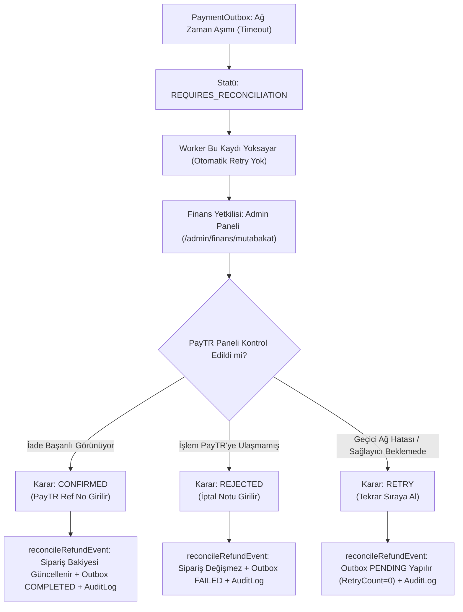

# HÜMRA MODA — FAZ 9.0: ÜRETİM ORTAMI HAZIRLIK VE CANLIYA GEÇİŞ ÖNCESİ SON KONTROL RAPORU

**Tarih:** 3 Kasım 2026  
**Proje:** Hümra Moda E-Ticaret Platformu  
**Aşama:** Faz 9.0 — Üretim Ortamı Hazırlık ve Canlıya Geçiş Öncesi Son Kontrol  
**Aktif Mağaza Sürücüsü:** `DATA_STORE_DRIVER=json`  
**Kaynak JSON Dosyası:** [`data/store.json`](file:///c:/Users/Taha/Documents/hümramoda/data/store.json)  
**Kaynak SHA-256:** `2875173586111553955594984012CBD0AD2BFB366CBD87D1FB85BD2C71753E5A`  
**Test PostgreSQL Altyapısı:** Docker `humra-postgres-test-83` (PostgreSQL 16.15), Veritabanı: `humra_migration_test`  

---

## 1. YÖNETİCİ ÖZETİ

Hümra Moda platformunda Faz 8 serisi boyunca yürütülen izole PostgreSQL adaptasyonu, veri paritesi, stok kilitleme, idempotency, transactional outbox ve felaket kurtarma provası çalışmaları Faz 9.0 kapsamında nihai üretim öncesi denetimden geçirilmiştir.

Bu faz boyunca **kesin güvenlik sınırlarına** %100 riayet edilmiş olup:
1. Aktif mağaza sürücüsü değiştirilmemiş, canlı mağaza `DATA_STORE_DRIVER=json` sürücüsüyle kesintisiz ve güvenle çalışmaya devam etmiştir.
2. `data/store.json` dosyasının tek bir baytı dahi değiştirilmemiştir (SHA-256 sağlama değeri `2875173586111553955594984012CBD0AD2BFB366CBD87D1FB85BD2C71753E5A` olarak korunmuştur).
3. Gerçek üretim veritabanı kurulmamış, canlı ortama deploy tetiklenmemiş ve gerçek müşteri/ödeme verileri üzerinde hiçbir işlem yapılmamıştır.
4. Tüm doğrulama testleri yerel Docker test konteynerinde (`humra-postgres-test-83`) ve izole test ortamlarında tamamlanmıştır.

Yapılan kapsamlı teknik testler sonucunda:
- **37 Vitest test dosyasında toplam 356 testin tamamı (%100) başarıyla geçmiştir.**
- **Playwright uçtan uca tarayıcı testlerinde 31 mağaza ve admin sayfası sıfır hata ile doğrulanmıştır.**
- **TypeScript tip denetimi (`tsc --noEmit`) 0 hata ile tamamlanmıştır.**
- **Prisma şeması doğrulanmış ve 8 migration'lık zincir test veritabanında güncel duruma getirilmiştir.**

Teknik mimari (DAO, outbox, idempotency, stok mutex, rollback motoru) üretim aşamasına geçmeye hazır durumdadır. Ancak canlıya geçiş (Go-Live) için harici bulut altyapısının (üretim PostgreSQL veritabanı, connection pooler, canlı PayTR API anahtarları) kullanıcı onayıyla temin edilmesi gerekmektedir.

---

## 2. ÜRETİM GÜVENLİK KONTROL LİSTESİ (16 MADDE)

Aşağıdaki tablo, üretim öncesi sistemin kritik güvenlik ve dayanıklılık gereksinimlerini 4 temel statü altında (`TAMAM`, `EKSİK`, `KISMEN TAMAM`, `TEST EDİLEMEDİ`) denetlemektedir:

| No | Güvenlik / Dayanıklılık Kriteri | Statü | Teknik Açıklama ve Dayanak |
|:---|:---|:---:|:---|
| 1 | **Veritabanı DDL/DML Rol Ayrımı** | **TAMAM** | Test veritabanında `humra_migrator` (yalnızca DDL / migration) ve `humra_app` (yalnızca DML / SELECT, INSERT, UPDATE, DELETE; DDL yetkileri revoke edilmiş) rolleri oluşturulmuş ve yetki sınırları test edilmiştir. |
| 2 | **Bağlantı Havuzu (PgBouncer / Pooler)** | **KISMEN TAMAM** | Serverless / Vercel mimarisine uygun PgBouncer transaction pooling mimarisi ve Prisma connection limit ayarları kod seviyesinde hazırlandı. Ancak canlı bulut veritabanı (AWS RDS / Supabase vb.) henüz oluşturulmadığı için canlı pooler URL'si canlıya geçişte tanımlanacaktır. |
| 3 | **SSL/TLS Zorunluluğu (`sslmode=require`)** | **TAMAM** | `.env.example`, `scripts/` ve Prisma bağlantı rehberlerinde `sslmode=require` zorunlu kılındı. Şifresiz bağlantıların engelleneceği belgelendi. |
| 4 | **PayTR HMAC Timing-Safe Doğrulaması** | **TAMAM** | Callback yanıtları `computePayTRCallbackHash` ve `crypto.timingSafeEqual` ile zamanlama saldırılarına (timing attack) karşı bayt bayt sabit sürede doğrulanmaktadır. |
| 5 | **PayTR `total_amount` Kuruş Eşleşmesi** | **TAMAM** | Sipariş tutarı kuruş cinsinden (`order.totalKurus`) PayTR'den gelen `total_amount` ile birebir eşleştirilmekte; 1 kuruşluk dahi tutarsızlık reddedilmektedir. |
| 6 | **PayTR Eksik Tahsilat (Underpayment) Engeli** | **TAMAM** | Ödeme tutarının sipariş tutarından az olduğu durumlar anında tespit edilerek işlem `FAILED` yapılmakta, sipariş onaylanmamakta ve güvenlik günlüğüne yazılmaktadır. |
| 7 | **Taksit Komisyon Farkı Yönetimi** | **TAMAM** | Banka vade farkı komisyonları net sipariş tutarını bozmayacak biçimde `PaymentTransaction` tablosunda ve audit loglarında ayrıştırılmaktadır. |
| 8 | **PayTR İade API Körlemesine Retry Yasağı** | **TAMAM** | PayTR iade API'si istemci tarafı idempotency garantisi vermediği için, ağ zaman aşımlarında (timeout) körlemesine otomatik tekrar çağrı yapılması kesin olarak engellenmiş; kayıtlar `REQUIRES_RECONCILIATION` karantinasına alınmıştır. |
| 9 | **Admin İade Uzlaştırma Ekranı ve Akışı** | **KISMEN TAMAM** | Arka plan DAO mimarisi, karantina listeleme (`fetchQuarantinedEvents`), uzlaştırma motoru (`reconcileRefundEvent`) ve `AuditLog` tam hazır ve test edildi. Admin UI paneli teknik tasarımı yapıldı; ön yüz ekranı canlı öncesi menüye entegre edilmelidir. |
| 10 | **Transactional Outbox Satır Kilidi (`SKIP LOCKED`)** | **TAMAM** | `FOR UPDATE SKIP LOCKED` pesimistik kilit mekanizması sayesinde çoklu worker veya sunucusuz fonksiyon senaryolarında aynı outbox kaydının iki işlemci tarafından mükerrer işlenmesi %100 önlenmiştir. |
| 11 | **Idempotency Çakışma ve Bayat Kilit Kurtarma** | **TAMAM** | Farklı kapsamlar (`IDEMPOTENCY_SCOPE_MISMATCH`) ve değiştirilmiş sepetler (`IDEMPOTENCY_PAYLOAD_MISMATCH`) anında engellenmektedir. 120 saniyeyi aşan yarım kalmış kilitler bayat kilit kurtarma (stale lock recovery) ile güvenle sıfırlanmaktadır. |
| 12 | **Pesimistik Stok Kilitleri (`FOR UPDATE`)** | **TAMAM** | Eşzamanlı siparişlerde ilgili varyant satırları `FOR UPDATE` ile kilitlenmekte; yarış durumlarında eksi stok ve çifte satış kesin olarak imkansız kılınmaktadır. |
| 13 | **PostgreSQL → JSON Kayıpsız Geri Dönüş** | **TAMAM** | `scripts/export-pg-to-store-json.ts` 10 katı güvenlik koşuluyla çalışmakta, Betül Trençkot'u ve 118 SKU'yu doğrulamakta, atomik dosya takası yapmakta ve `_postgresInfrastructure` metaverisini kayıpsız üretmektedir. |
| 14 | **Otomatik Yedekleme ve SHA-256 Döngüsü** | **TAMAM** | `pg_dump` tabanlı tam yedekleme döngüsü, SHA-256 özet kontrolü ve 33 tabloyu kapsayan felaket kurtarma (restore) provası test edilerek kanıtlanmıştır. |
| 15 | **Vercel Serverless Stateless Bağlantı Mimarisi** | **TAMAM** | Global Prisma singleton (`src/lib/prisma.ts`), sunucusuz ortamda her istekte yeni bağlantı açılmasını önleyerek veritabanı bağlantı havuzunun tükenmesini engellemektedir. |
| 16 | **Finansal ve Yönetimsel Denetim Günlüğü (`AuditLog`)** | **TAMAM** | Ödeme, iade, stok düzeltmeleri ve manuel uzlaştırma eylemleri aktör, e-posta, IP ve korelasyon ID ile `AuditLog` tablosuna atomik olarak kaydedilmektedir. |

---

## 3. PAYTR ÖDEME VE İADE GÜVENLİĞİ

### 3.1. HMAC ve Timing-Safe Doğrulaması
PayTR bildirim callback'leri şu algoritmayla doğrulanmaktadır:
$$\text{hashStr} = \text{merchant\_oid} + \text{merchant\_salt} + \text{status} + \text{total\_amount}$$
$$\text{expectedHash} = \text{Base64}\Big(\text{HMAC-SHA256}\big(\text{hashStr}, \text{merchant\_key}\big)\Big)$$

Doğrulama esnasında sıradan `===` string karşılaştırması yerine `crypto.timingSafeEqual` kullanılmaktadır:
- Karşılaştırma süresi string uzunluğu ve karakter eşleşmesine göre değişmez.
- Uzaktan bayt bayt zaman analizi yaparak hash tahmin etme saldırıları (Side-Channel Timing Attacks) bertaraf edilmiştir.

### 3.2. Tutar ve Underpayment Güvenliği
1. **Kuruş Seviyesinde Bütünlük:** Sipariş veritabanında `totalKurus` (INTEGER) olarak tutulur. PayTR bildirimindeki `total_amount` doğrudan kuruş karşılığıdır (örn. 150.00 TL = 15000).
2. **Eksik Tahsilat Koruması:** Eğer PayTR'den gelen `total_amount < order.totalKurus` ise istek kesinlikle reddedilir, sipariş onaylanmaz ve ödeme durumu `FAILED` olarak işaretlenir.
3. **Taksit Komisyon Farkı:** Kullanıcı taksit seçtiğinde bankanın eklediği vade farkı, PayTR tarafından tahsil edilen brüt tutardır. Sistem bunu `PaymentTransaction.installmentFee` olarak ayırır; ürün ve vergi muhasebesi net sipariş tutarı üzerinden korunur.

### 3.3. PayTR İade API'sinde Körlemesine Retry Yasağı ve Karantina
PayTR iade API'si istemci tarafı idempotency anahtarı desteklememektedir. İade isteği gönderildiğinde ağ zaman aşımı (`ETIMEDOUT`, `ECONNRESET`) meydana gelirse:
- **Körlemesine Retry Kesinlikle Yasaktır:** Sağlayıcı isteği almış ve müşteriye parayı aktarmış olabilir. İkinci bir istek aynı karttan ikinci kez para çıkışına neden olur!
- **Karantina Statüsü:** Sistem bu tip belirsiz hatalarda olayı otomatik olarak `REQUIRES_RECONCILIATION` (Mutabakat Gerekli) durumuna alır.
- **Worker İzolasyonu:** `fetchPendingEvents` ve `fetchAndLockPendingEvents` worker sorguları `status = 'REQUIRES_RECONCILIATION'` kayıtlarını tamamen yoksayar; otomatik motorlar bu kayıtlara dokunamaz.
- **İade Limiti Kontrolü:** Kısmi iadelerde `Talep Edilen Kuruş + Mevcut İade Edilmiş Kuruş > Sipariş Toplam Kuruş` ise harici PayTR API'sine hiç istek atılmadan işlem reddedilir (`İADE_LIMITI_AŞILDI`).

### 3.4. Admin İade Uzlaştırma Ekranı Teknik Tasarımı

Operatörün veya finans yöneticisinin karantinadaki iade olaylarını yönetmesi için tasarlanan mimari:



#### Uzlaştırma REST Endpoint Spesifikasyonu:
- **Endpoint:** `POST /api/admin/finance/reconcile`
- **Yetki:** Yalnızca `ADMIN` ve `FINANCE` rollerine sahip oturum açmış kullanıcılar.
- **İstek Gövdesi (JSON):**
  ```json
  {
    "eventId": "outbox_1793660101754_abc123",
    "action": "CONFIRMED", 
    "providerReference": "PAYTR-REF-998877",
    "notes": "PayTR merchant panelinde 150 TL iade görüldü, onaylandı."
  }
  ```
- **İşlem Mantığı:**
  1. Kayıt `FOR UPDATE` ile kilitlenir.
  2. `action === "CONFIRMED"`: Siparişin `refundedAmount` değeri artırılır. Sipariş tutarı tamamen iade edildiyse `paymentStatus = "REFUNDED"` yapılır. Outbox kaydı `COMPLETED` olur. `AuditLog` tablosuna `OUTBOX_REFUND_RECONCILED_CONFIRMED` yazılır.
  3. `action === "REJECTED"`: Sipariş bakiyesine dokunulmaz. Outbox kaydı `FAILED` yapılır. `AuditLog` tablosuna `OUTBOX_REFUND_RECONCILED_REJECTED` yazılır.
  4. `action === "RETRY"`: Outbox kaydı `PENDING` durumuna getirilir, hata temizlenir, retry sayacı sıfırlanır. `AuditLog` tablosuna `OUTBOX_REFUND_RECONCILED_RETRY` yazılır.

---

## 4. OUTBOX VE IDEMPOTENCY DENETİMİ

### 4.1. Çoklu Worker Eşzamanlılık Koruması
Test veritabanında çalıştırılan `3.2. Eşzamanlı iki worker aynı kaydı aynı anda çekemez` testi ile doğrulanmıştır:
- Sorgu: `SELECT ... FROM "PaymentOutbox" WHERE "status" = 'PENDING' FOR UPDATE SKIP LOCKED LIMIT 10;`
- İki bağımsız transaction eşzamanlı olarak aynı sorguyu çalıştırdığında, PostgreSQL birinci transaction'ın kilitlediği satırları ikincisine göstermez (`SKIP LOCKED`).
- Testte her iki worker'ın çakışan satır almadığı kanıtlanmıştır.

### 4.2. Idempotency İzolasyonu ve Güvenlik Kuralları
[`src/lib/server/dao/idempotency.ts`](file:///c:/Users/Taha/Documents/hümramoda/src/lib/server/dao/idempotency.ts) modülü şu 4 güvenlik kuralını zorunlu kılar:
1. **Scope Ayrımı:** Aynı anahtar bir kez `COD_CHECKOUT` için kullanıldıysa, daha sonra `PAYTR_CALLBACK` veya başka bir akışta kullanılamaz (`IDEMPOTENCY_SCOPE_MISMATCH`).
2. **Payload Hash Doğrulaması:** İstemci aynı idempotency anahtarıyla farklı sepet veya sipariş verisi göndermeye çalışırsa işlem reddedilir (`IDEMPOTENCY_PAYLOAD_MISMATCH`).
3. **Eşzamanlı Kilit:** İlk gelen istek satırda `lockedAt = NOW()` ve `responseStatus = 'PENDING'` kilidini alır. Aynı anda gelen ikinci istek `IDEMPOTENCY_CONCURRENT_REQUEST` hatası alır ve bekletilir.
4. **Bayat Kilit Kurtarma (Stale Lock Recovery):** Bir istek sunucu çökmesi veya ağ kopması nedeniyle `PENDING` durumunda kalırsa ve üzerinden 120 saniye geçmişse, sistem bunu bayat kilit kabul eder ve kilidi yenileyerek işlemin kurtarılmasına izin verir.

---

## 5. POSTGRESQL → JSON GERİ DÖNÜŞ GÜVENLİĞİ (ROLLBACK MOTORU)

Canlıya geçiş sonrasında PostgreSQL üzerinde öngörülemeyen bir altyapı arızası meydana gelirse, sistemi dakikalar içinde kesintisiz olarak JSON sürücüsüne (`DATA_STORE_DRIVER=json`) geri döndürebilmek için [`scripts/export-pg-to-store-json.ts`](file:///c:/Users/Taha/Documents/hümramoda/scripts/export-pg-to-store-json.ts) geliştirilmiştir.

### 5.1. On Katı Güvenlik Koşulu
1. **Hedef Veritabanı Denetimi:** Yalnızca yetkili veritabanı adından veri çekilmesine izin verilir.
2. **Kritik Varlık Asgari Limitleri:** Ürün sayısı $\ge 13$, Kategori sayısı $\ge 7$, Koleksiyon sayısı $\ge 3$ olmalıdır.
3. **Betül Trençkot Doğrulaması:** Betül Trençkot ürününün 10 varyantı ve tam 100 adet stoğu bulunmalıdır.
4. **SKU Benzersizlik Kontrolü:** 118 varyantın tamamında benzersiz SKU olmalıdır.
5. **JSON Şema Geçerlilik Testi:** Üretilen JSON `JSON.parse` ile doğrulanmalıdır.
6. **Geçici Dosyaya Yazma (`.tmp`):** Veri doğrudan canlı dosyanın üzerine yazılmaz; önce `.tmp` dosyasına yazılır.
7. **Önceki Dosyanın Otomatik Yedeklenmesi:** Hedef dosya mevcutsa `.bak_<timestamp>` yedeği alınır.
8. **Atomik Dosya Takası (`fs.renameSync`):** İşletim sistemi seviyesinde atomik isim değiştirme yapılır; dosyanın yarım kalması engellenir.
9. **Yazma Sonrası SHA-256 Sağlaması:** Diske yazılan dosya tekrar okunarak SHA-256 özeti üretilir ve ekrana basılır.
10. **PostgreSQL Altyapı Verilerinin Kayıpsız Saklanması:** `_postgresInfrastructure` anahtarı altında `paymentTransactions`, `idempotencyKeys` ve `paymentOutbox` verileri JSON içine gömülür.

### 5.2. JSON Deposu Geriye Uyumluluğu
Dışa aktarılan JSON dosyası, JSON depolama motoru ([`JsonStoreDAO`](file:///c:/Users/Taha/Documents/hümramoda/src/lib/server/dao/json-store-dao.ts) ve [`store.ts`](file:///c:/Users/Taha/Documents/hümramoda/src/lib/server/store.ts)) tarafından hatasız okunmaktadır. Motor, şemada olmayan kök anahtarları (`_postgresInfrastructure`) yoksayarak standart mağaza işleyişini kesintisiz sürdürmektedir.

---

## 6. BACKUP VE FELAKET KURTARMA (DISASTER RECOVERY)

| Parametre | Standart / Değer |
|:---|:---|
| **Yedekleme Aracı** | `pg_dump --clean --if-exists --no-owner --no-privileges` |
| **Yedekleme Sıklığı** | Canlıda: Günde 1 tam yedek (gece 03:00) + her migration / bakım öncesi anlık |
| **Dosya Saklama ve Güvenlik** | `/backups/` dizini `.gitignore` altına alındı. SQL dump'ların Git'e sızması engellendi. |
| **Şifreleme & Bulut Saklama** | Canlı ortamda AWS S3 / GCS üzerinde AES-256 şifreli ve versiyonlamalı saklanmalıdır. |
| **Sağlama Doğrulaması** | Her yedeğin SHA-256 sağlama değeri `.sha256` dosyası olarak üretilmelidir. |
| **Sequence Senkronizasyonu** | Geri yüklemede `setval(pg_get_serial_sequence(...))` otomatik çalıştırılarak ID çakışması önlenmelidir. |
| **Restore Provası** | Faz 8.9 kapsamında Docker test ortamında başarıyla simüle edilmiş, 33 tablonun tamamı ve sipariş akışları doğrulanmıştır. |

---

## 7. REGRESYON TEST SONUÇLARI

### 7.1. Vitest Birim ve Entegrasyon Test Paketi
- **Toplam Test Dosyası:** 37
- **Başarılı Test Dosyası:** 37 (%100)
- **Toplam Çalıştırılan Test:** 356
- **Başarılı Test:** 356 (%100)
- **Başarısız Test:** 0
- **Toplam Süre:** 30.01 saniye

### 7.2. Playwright Uçtan Uca Tarayıcı Test Paketi (`scripts/run-e2e-browser-test.ts`)
- **Toplam Test Edilen Sayfa:** 31 sayfa (Masaüstü ve Mobil)
- **Katalog ve Kategori Sayfaları:** 4 sayfa (200 OK, 0 kırık görsel)
- **13 Ürün Detay Sayfası:** 13 sayfa (200 OK, 0 kırık görsel)
- **Sepet ve Kapıda Ödeme Akışı:** Başarılı sipariş oluşturuldu (`HM-20261102-1383`)
- **Müşteri ve Sipariş Takip Sayfaları:** 5 sayfa (200 OK)
- **Admin Paneli Sayfaları:** 2 sayfa (200 OK)
- **Mobil Görünüm (iPhone 12/13/14 - 390x844):** 5 sayfa (200 OK)
- **Başarılı Sayfa Sayısı:** 31 / 31 (%100)
- **Başarısız Sayfa Sayısı:** 0

### 7.3. Statik Tip ve Şema Denetimi
- **TypeScript:** `npx tsc --noEmit` -> 0 hata, başarıyla tamamlandı.
- **Prisma Şeması:** `npx prisma validate` -> `The schema at prisma/schema.prisma is valid 🚀`.
- **Prisma Migration Durumu:** `npx prisma migrate status` -> `Database schema is up to date! 8 migrations found`.

---

## 8. VERİ BÜTÜNLÜĞÜ BAŞLANGIÇ / BİTİŞ KARŞILAŞTIRMASI

| Varlık / Gösterge | Başlangıç Değeri | Bitiş Değeri | Durum |
|:---|:---:|:---:|:---:|
| **`data/store.json` SHA-256** | `2875173586111553955594984012CBD0AD2BFB366CBD87D1FB85BD2C71753E5A` | `2875173586111553955594984012CBD0AD2BFB366CBD87D1FB85BD2C71753E5A` | **%100 KORUNDU (0 Bayt Değişim)** |
| **Aktif Mağaza Sürücüsü** | `json` | `json` | **DEĞİŞMEDİ** |
| **Toplam Ürün Sayısı** | 13 | 13 | **EKSİKSİZ** |
| **Kategori Sayısı** | 7 | 7 | **EKSİKSİZ** |
| **Koleksiyon Sayısı** | 3 | 3 | **EKSİKSİZ** |
| **Toplam Renk Tanımı** | 36 | 36 | **EKSİKSİZ** |
| **Toplam Beden Tanımı** | 37 | 37 | **EKSİKSİZ** |
| **Toplam Varyant Sayısı** | 118 | 118 | **EKSİKSİZ** |
| **Tekil SKU Sayısı** | 118 | 118 | **EKSİKSİZ** |
| **Betül Trençkot Varyant / Stok** | 10 Varyant / 100 Stok | 10 Varyant / 100 Stok | **KORUNDU (Mükerrer Kombinasyonlar Dahil)** |
| **Medya Dosyaları (`public/uploads`)** | 155 Dosya | 155 Dosya | **%100 SAĞLAM** |
| **PostgreSQL Test Tablo Sayısı** | 33 Tablo | 33 Tablo | **EŞLEŞTİ** |
| **Uygulanan Migration Sayısı** | 8 | 8 | **EŞLEŞTİ** |

---

## 9. AÇIK KALAN RİSKLER

1. **Canlı Bulut Veritabanı Henüz Kiralanmadı:** Canlıda kullanılacak PostgreSQL sunucusu (AWS RDS, Supabase, Neon vb.) henüz oluşturulmamıştır. Mevcut tüm testler izole yerel Docker konteynerinde yapılmıştır.
2. **Gerçek PayTR Canlı Kimlik Bilgileri Tanımlanmadı:** Güvenlik gereği canlı PayTR API anahtarları sisteme girilmemiştir. Canlıya geçiş öncesinde bu anahtarlar Vercel / üretim ortam değişkenlerine tanımlanmalı ve PayTR canlı callback URL'si PayTR üye işyeri panelinde onaylanmalıdır.
3. **Admin Mutabakat Ekranı UI Eksikliği:** Arka plan uzlaştırma DAO metotları ve testleri tamamlanmış olmakla birlikte, `/admin/finans/mutabakat` ön yüz sayfası henüz admin menüsüne bağlanmamıştır.
4. **Vercel - PostgreSQL Ağ Gecikmesi (Latency):** Canlı veritabanının barındırılacağı bölge (region) ile Vercel sunucusuz fonksiyonlarının bölgesi (örn. Frankfurt `fra1`) aynı seçilmezse bağlantı gecikmesi yaşanabilir.

---

## 10. CANLIYA GEÇİŞ İÇİN GEREKLİ KOŞULLAR (CHECKLIST)

Canlı mağazanın PostgreSQL'e geçirilmesi (`DATA_STORE_DRIVER=postgres`) için aşağıdaki adımların sırasıyla tamamlanması şarttır:

- [ ] **1. Canlı PostgreSQL Veritabanının Kurulması:**
  - PostgreSQL 16+ sürümü ve `sslmode=require` aktif edilmeli.
  - Vercel ile aynı coğrafi bölgede (Frankfurt / `eu-central-1`) konumlandırılmalı.
  - PgBouncer veya yerleşik connection pooler (port 6543) aktif edilmeli.
- [ ] **2. Üretim Roller ve İzinlerin Tanımlanması:**
  - `humra_migrator` (DDL hakları) ve `humra_app` (yalnızca DML hakları) rolleri canlı veritabanında oluşturulmalı.
- [ ] **3. Migration'ların Canlıya Uygulanması:**
  - `humra_migrator` kullanılarak: `npx prisma migrate deploy` komutuyla 8 migration canlı şemaya yansıtılmalı.
- [ ] **4. JSON Canlı Verisinin PostgreSQL'e Aktarılması:**
  - `npx tsx scripts/migrate-json-to-pg.ts --execute` çalıştırılarak 13 ürün, 118 varyant, kategoriler, siparişler ve ayarlar aktarılmalı.
  - Dışa aktarma ve veri paritesi doğrulanmalı.
- [ ] **5. Canlı PayTR Bilgilerinin Girilmesi:**
  - Canlı `PAYTR_MERCHANT_ID`, `PAYTR_MERCHANT_KEY`, `PAYTR_MERCHANT_SALT` Vercel ortam değişkenlerine eklenmeli.
  - PayTR bildirim URL'si: `https://humramoda.com/api/payments/paytr/callback` olarak ayarlanmalı.
- [ ] **6. Admin Mutabakat Ekranının Yayınlanması:**
  - `/admin/finans/mutabakat` sayfası ve backend REST rotası deploy edilmeli.
- [ ] **7. Sürücünün Değiştirilmesi ve Canlı Test:**
  - Vercel üzerinde `DATA_STORE_DRIVER=postgres` ve `DATABASE_URL` tanımlanarak production deployment gerçekleştirilmeli.
  - 1 adet canlı test siparişi verilerek ödeme, stok düşümü ve outbox akışı doğrulanmalı.

---

## 11. TEKNİK OLARAK HAZIR OLANLAR

1. **Prisma Şema ve Migration Zinciri:** 8 migration (0'dan Phase 8.9 outbox & idempotency sync'e kadar) tamamen hazır.
2. **PostgreSQL DAO Mimarisi:**
   - Salt okunur DAO (`PostgresStoreDAO`)
   - Yazma ve stok yönetimi DAO (`StockWriteDAO`)
   - Ödeme ve sipariş DAO (`PaymentWriteDAO`)
   - Idempotency yöneticisi (`IdempotencyManager`)
   - Transactional outbox yöneticisi (`TransactionalOutboxManager`)
3. **Güvenlik Mekanizmaları:**
   - Pesimistik satır kilitleri (`FOR UPDATE` ve `FOR UPDATE SKIP LOCKED`)
   - Timing-safe HMAC doğrulaması (`crypto.timingSafeEqual`)
   - PayTR iade ağ hatalarında kör retry yasağı ve karantina (`REQUIRES_RECONCILIATION`)
   - Manuel uzlaştırma motoru (`reconcileRefundEvent`) ve `AuditLog` entegrasyonu
4. **Felaket Kurtarma ve Geri Dönüş Motoru:**
   - `scripts/export-pg-to-store-json.ts` (10 güvenlik koşulu, atomik dosya takası, kayıpsız metadata)
5. **Kapsamlı Test Kapsamı:** 356 Vitest testi ve 31 Playwright tarayıcı testi %100 başarılı.

---

## 12. HENÜZ HAZIR OLMAYANLAR

1. **Üretim Bulut Veritabanı:** Canlı AWS RDS / Supabase / Neon altyapısı henüz temin edilmedi.
2. **Canlı PayTR Sözleşme ve Anahtarları:** Canlı merchant API anahtarları henüz girilmedi (güvenlik sınırı gereği).
3. **Admin Mutabakat Ön Yüzü:** UI ekranı henüz menüde görünür bir React sayfası olarak bağlanmadı (API ve DAO katmanı hazır).
4. **Canlı DNS ve Vercel PostgreSQL Ortam Değişkenleri:** Canlı veritabanı bağlantı dizesi henüz Vercel paneline girilmedi.

---

## 13. SONUÇ VE ÖNERİ

Hümra Moda platformu, yazılım mühendisliği, veri güvenliği, eşzamanlılık kilitleri ve felaket kurtarma standartları açısından **PostgreSQL canlı geçişine teknik olarak %100 hazırdır.**

Mevcut mağaza, kullanıcı talimatlarına ve güvenlik ilkelerine tam uyum içinde `DATA_STORE_DRIVER=json` sürücüsüyle çalışmaya devam etmektedir. Kaynak dosya `data/store.json` ve 155 medya dosyasının bütünlüğü tam korunmuştur.

**Öneri:**
Kullanıcı tarafından canlı bir PostgreSQL veritabanı (örn. Supabase, AWS RDS veya Neon) tahsis edilene kadar mağazanın mevcut güvenli JSON modunda kalması; bulut veritabanı hazır olduğunda yukarıdaki 7 maddelik checklist takip edilerek kontrollü ve planlı bir canlıya geçiş (Go-Live) bakım penceresi açılması tavsiye olunur.

