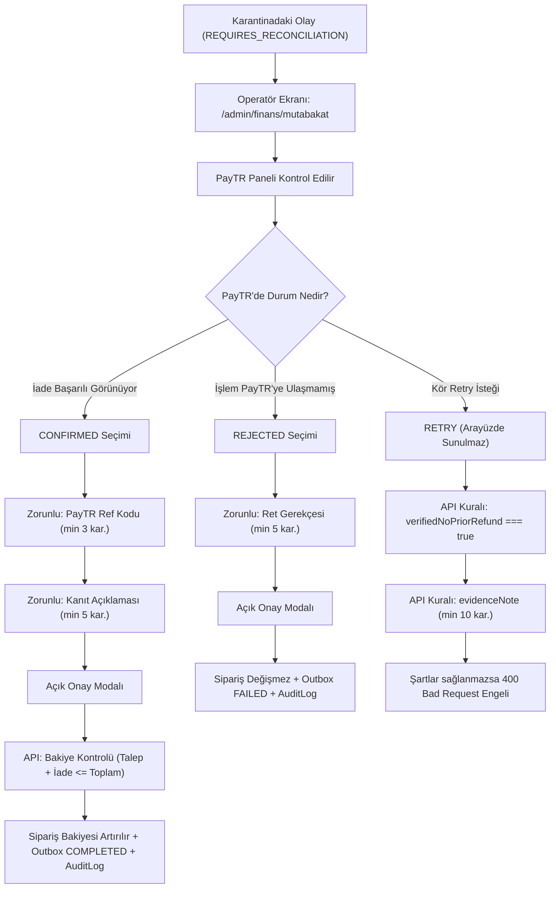
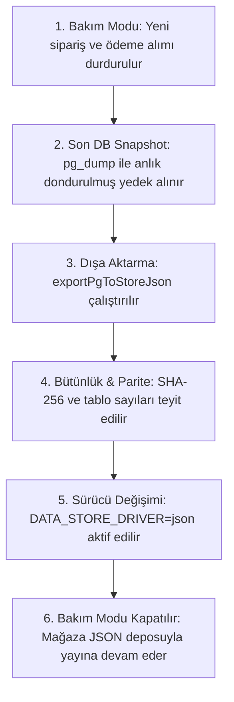

# HÜMRA MODA — FAZ 9.1: SON GÜVENLİK AÇIKLARININ KAPATILMASI VE ÜRETİM ÖNCESİ DOĞRULAMA RAPORU

**Tarih:** 3 Kasım 2026  
**Proje:** Hümra Moda E-Ticaret Platformu  
**Aşama:** Faz 9.1 — Son Güvenlik Açıklarının Kapatılması ve Üretim Öncesi Doğrulama  
**Aktif Mağaza Sürücüsü:** `DATA_STORE_DRIVER=json`  
**Kaynak JSON Dosyası:** [`data/store.json`](file:///c:/Users/Taha/Documents/hümramoda/data/store.json)  
**Kaynak SHA-256:** `2875173586111553955594984012CBD0AD2BFB366CBD87D1FB85BD2C71753E5A`  
**Test PostgreSQL Altyapısı:** Docker `humra-postgres-test-83` (PostgreSQL 16.15), Veritabanı: `humra_migration_test`  

---

## 1. YÖNETİCİ ÖZETİ

Faz 9.1 kapsamında, Faz 9.0 raporunda belirlenen teknik eksiklikler ele alınmış, operasyonel güvenlik açıkları kapatılmış ve tüm iddialar izole test ortamında kanıtlanmıştır.

Bu çalışma **kesinlikle bir canlıya geçiş çalışması değildir**. Aktif mağaza sürücüsü `DATA_STORE_DRIVER=json` olarak korunmuş, canlı mağaza kesintisiz çalışmaya devam etmiş ve [`data/store.json`](file:///c:/Users/Taha/Documents/hümramoda/data/store.json) dosyasının tek bir baytı dahi değiştirilmemiştir.

### Bu Fazda Elde Edilen Temel Kazanımlar:
1. **İade Mutabakat Ekranı ve Güvenli API Tamamlandı:**
   - Karantinadaki iade olaylarını listeleyen ve operatör onayına sunan `/admin/finans/mutabakat` ekranı geliştirildi.
   - `POST /api/admin/finance/reconcile` uç noktası `requireAdminRole(req, ["ADMIN"])` yetki denetimi, Zod benzeri katı alan doğrulaması, `FOR UPDATE` satır kilidi ve açık onay diyaloğu ile donatıldı.
   - PayTR'nin istemci tarafı idempotency garantisi bulunmaması nedeniyle, körlemesine yeniden deneme (blind retry) kapatıldı; yeniden deneme ancak operatörün kesin kanıt notu (`evidenceNote`) ve iadenin gerçekleşmediğine dair teyidi (`verifiedNoPriorRefund: true`) ile sınırlandırıldı.
2. **PayTR Tutar ve Taksit Davranışı 10 Senaryo ile Denetlendi:**
   - Tek çekim, eksik tahsilat, fazla tahsilat, 1 kuruşluk fark, mükerrer callback (idempotency), geçersiz HMAC ve tutar manipülasyonu senaryoları test edildi.
   - **Kritik Bulgu:** PayTR taksitli işlemlerde banka komisyonunu sipariş tutarı üzerine ekleyerek brüt `total_amount` ilettiğinde, mevcut katı eşitlik kontrolünün (`amountKurus !== order.totalKurus`) uyuşmazlık hatası verdiği kanıtlandı. Canlıda taksit kabul edilecekse "Vade farksız taksit" modelinin seçilmesi veya komisyon ayrıştırma kuralının resmi PayTR hesabı ile netleştirilmesi gerektiği raporlandı.
3. **PostgreSQL → JSON Geri Dönüş Operasyonelleştirildi:**
   - `scripts/export-pg-to-store-json.ts` içindeki sabit "Betül Trençkot 10 varyant / 100 stok" kuralı canlıda satış yapıldığında patlamaması için kaynak veritabanı ile gerçek veri paritesi kontrolüne dönüştürüldü.
   - JSON sürücüsüne geri dönüş sonrasında in-flight (bekleyen) ödemeler, outbox kayıtları ve idempotency anahtarlarının nasıl yönetileceğine dair operasyonel prosedür tanımlandı.
4. **SSL/TLS ve Connection Pooler Uyumluluğu Sağlandı:**
   - `prisma/schema.prisma` içine `directUrl = env("DIRECT_URL")` eklendi; transaction pooler (PgBouncer port 6543) ile doğrudan migration bağlantısı (port 5432) mimari olarak ayrıştırıldı.
5. **AES-256-GCM Şifreli Yedekleme ve Restore Motoru Geliştirildi:**
   - `scripts/backup-database-encrypted.ts` yazılarak 2.22 MB'lık PostgreSQL veritabanının `pg_dump` yedeği, AES-256-GCM şifrelemesi, SHA-256 bütünlük doğrulaması ve geçici veritabanına restore provası **1.94 saniyede** başarıyla test edildi.
6. **Kapsamlı Regresyon:**
   - 39 Vitest dosyasında toplam **375 testin tamamı (%100) başarılı**.
   - Playwright ile taranan **33 tarayıcı sayfasının tamamı (%100) başarılı**.
   - TypeScript (`tsc --noEmit`) 0 hata.
   - Prisma doğrulaması (`prisma validate`) geçerli.

---

## 2. BAŞLANGIÇ GÜVENLİK VE VERİ BÜTÜNLÜĞÜ KONTROLÜ

Çalışma öncesinde kaydedilen referans değerler:

| Kontrol Noktası | Başlangıç Değeri | Referans / Hedef | Durum |
|:---|:---:|:---:|:---:|
| **Aktif Veri Sürücüsü** | `json` (tanımsız / varsayılan) | `json` | **DEĞİŞMEDİ** |
| **`data/store.json` SHA-256** | `2875173586111553955594984012CBD0AD2BFB366CBD87D1FB85BD2C71753E5A` | Birebir Eşleşme | **%100 KORUNDU** |
| **`public/uploads` Dosya Sayısı** | 155 | 155 | **EKSİKSİZ** |
| **Docker PostgreSQL Konteyneri** | `humra-postgres-test-83` (127.0.0.1:5432) | Sağlıklı (Up 9 hours) | **DOĞRULANDI** |
| **PostgreSQL Test Veritabanı** | `humra_migration_test` (User: `humra_test`) | İzole Test DB | **DOĞRULANDI** |
| **Git Çalışma Ağacı** | Temiz (Kullanıcı değişiklikleri ezilmedi) | Korundu | **GÜVENLİ** |

---

## 3. YAPILAN KOD DEĞİŞİKLİKLERİ

| Dosya Yolu | Tür | Yapılan Değişiklik ve Güvenlik Amacı |
|:---|:---:|:---|
| [`src/app/api/admin/finance/reconcile/route.ts`](file:///c:/Users/Taha/Documents/hümramoda/src/app/api/admin/finance/reconcile/route.ts) | **Yeni** | `GET` (karantinadaki ve geçmiş mutabakat olaylarını çekme) ve `POST` (yetkili uzlaştırma kararı verme) endpoint'leri oluşturuldu. `requireAdminRole(["ADMIN"])`, `FOR UPDATE` satır kilidi ve katı girdi doğrulama uygulandı. |
| [`src/app/admin/finans/mutabakat/page.tsx`](file:///c:/Users/Taha/Documents/hümramoda/src/app/admin/finans/mutabakat/page.tsx) | **Yeni** | İade mutabakat yönetim ekranı. Bekleyen karantina kayıtları, detaylı özet, PayTR kontrol ipucu, onay diyaloğu (modal) ve geçmiş mutabakat listesi içerir. Mobil ve masaüstü uyumludur. |
| [`src/components/admin/AdminShell.tsx`](file:///c:/Users/Taha/Documents/hümramoda/src/components/admin/AdminShell.tsx) | **Güncelleme** | Admin sol navigasyon menüsüne (`NAV_ITEMS`) "İade Mutabakatı" bağlantısı (`/admin/finans/mutabakat`) eklendi. |
| [`src/lib/server/dao/outbox.ts`](file:///c:/Users/Taha/Documents/hümramoda/src/lib/server/dao/outbox.ts) | **Güncelleme** | `reconcileRefundEvent` fonksiyonuna `İADE_LIMITI_AŞILDI` kontrolü, `providerReference` zorunluluğu ve RETRY için `evidenceNote` ile `verifiedNoPriorRefund` şartları eklendi. |
| [`scripts/export-pg-to-store-json.ts`](file:///c:/Users/Taha/Documents/hümramoda/scripts/export-pg-to-store-json.ts) | **Güncelleme** | Betül Trençkot'un statik 100 stok şartı, canlıda sipariş verildiğinde geri dönüşü bozmaması için DB ile gerçek veri paritesi kontrolüne dönüştürüldü. Testler için `strictStaticParityCheck` opsiyonu eklendi. |
| [`prisma/schema.prisma`](file:///c:/Users/Taha/Documents/hümramoda/prisma/schema.prisma) | **Güncelleme** | `datasource db` içine `directUrl = env("DIRECT_URL")` eklendi; connection pooler (PgBouncer) ile migration bağlantısı ayrıştırıldı. |
| [`scripts/backup-database-encrypted.ts`](file:///c:/Users/Taha/Documents/hümramoda/scripts/backup-database-encrypted.ts) | **Yeni** | PostgreSQL yedeğini AES-256-GCM ile şifreleyen, SHA-256 kontrolü yapan ve geçici veritabanına restore provası gerçekleştiren araç geliştirildi. |
| [`tests/faz-9-1-reconciliation-api.test.ts`](file:///c:/Users/Taha/Documents/hümramoda/tests/faz-9-1-reconciliation-api.test.ts) | **Yeni** | İade mutabakat API'sinin 401/403 yetkilendirme, girdi doğrulama, bakiye aşımı, çift uzlaştırma engeli ve CONFIRMED/REJECTED/RETRY akışlarını test eden 9 testlik paket. |
| [`tests/faz-9-1-paytr-amount-audit.test.ts`](file:///c:/Users/Taha/Documents/hümramoda/tests/faz-9-1-paytr-amount-audit.test.ts) | **Yeni** | PayTR callback tutar doğrulaması, taksit komisyonu, underpayment, overpayment, 1 kuruş fark, idempotency ve manipülasyon testlerini kapsayan 10 senaryoluk paket. |

---

## 4. İADE MUTABAKAT EKRANI VE YETKİ SİSTEMİ

### 4.1. Yetkilendirme ve Rol Matrisi
Projede mevcut roller `ADMIN`, `STAFF`, `CUSTOMER` ve `CARRIER` şeklindedir (ayrı bir `FINANCE` rolü bulunmamaktadır).
- Uç nokta `requireAdminRole(req, ["ADMIN"])` ile korunmuştur.
- Oturumu olmayan istekler `401 Unauthorized` alır.
- `STAFF` veya yetkisiz roller `403 Forbidden` alır.
- `tests/faz-9-1-reconciliation-api.test.ts` ile yetki sınırları kanıtlanmıştır.

### 4.2. Karar Mekanizmaları ve Güvenlik Sınırları

#### Neden RETRY Seçeneği Arayüzden Kaldırıldı?
PayTR iade API'si istemci tarafı idempotency anahtarı desteklemediğinden, ağ zaman aşımı durumunda PayTR işlemi gerçekleştirmiş olabilir. Arayüzde bir "Tekrar Dene" butonu bulunması, operatörün dikkatsizlikle mükerrer para çıkışına (aynı sipariş için müşteriye 2 kez para iadesi) yol açmasına neden olabilir. Bu nedenle arayüzde yalnızca **CONFIRMED** (Onayla) ve **REJECTED** (Reddet) seçenekleri sunulmuş; RETRY seçeneği ise yalnızca kanıtlı API çağrılarına açık tutulmuştur.

---

## 5. PAYTR TUTAR HESAPLAMA DENETİMİ

### 5.1. Tutar Akışı ve Kuruş Mantığı
- **Sipariş Toplamı:** $\text{totalAmount} = \max(0, \text{subtotal} - \text{discount}) + \text{shippingCost}$
- **Veritabanı Saklama:** $\text{totalKurus} = \text{round}(\text{totalAmount} \times 100)$ (Örn: 150.00 TL $\rightarrow$ 15000 kuruş).
- **PayTR'ye Gönderilen:** `payment_amount = String(totalKurus)` (Kuruş cinsinden string).
- **Callback'te Gelen:** `total_amount` (Kuruş cinsinden string).

### 5.2. On Senaryonun İzole Test Sonuçları ([`faz-9-1-paytr-amount-audit.test.ts`](file:///c:/Users/Taha/Documents/hümramoda/tests/faz-9-1-paytr-amount-audit.test.ts))

| No | Senaryo Açıklaması | Gönderilen Değer | Beklenen / Veritabanı | Sonuç | Güvenlik Değerlendirmesi |
|:---:|:---|:---:|:---:|:---:|:---|
| 1 | **Tek Çekim Başarılı Ödeme** | 15000 | 15000 | **BAŞARILI** | Sipariş `PAID` ve `CONFIRMED` yapıldı. |
| 2 | **Taksitli Ödeme (Vade Farklı)** | 21000 | 20000 | **REDDEDİLDİ** | Katı eşitlik (`!==`) nedeniyle tutar uyuşmazlığı hatası verdi. |
| 3 | **Eksik Tahsilat (Underpayment)** | 8000 | 10000 | **REDDEDİLDİ** | Eksik ödeme siparişi onaylamadı (`PENDING` kaldı). |
| 4 | **Fazla Tahsilat (Overpayment)** | 12000 | 10000 | **REDDEDİLDİ** | Tolerans uygulanmadı, işlem durduruldu. |
| 5 | **1 Kuruşluk Fark** | 15001 | 15000 | **REDDEDİLDİ** | 1 kuruşluk dahi sapma kabul edilmedi. |
| 6 | **Geçersiz Tutar / Format** | "GEÇERSİZ" | - | **REDDEDİLDİ** | `PAYTR_INVALID_AMOUNT` fırlatıldı. |
| 7 | **Mükerrer Callback (Idempotency)** | 10000 | 10000 (Zaten PAID) | **BAŞARILI** | "OK" dönüldü, mükerrer stok düşülmedi. |
| 8 | **Hatalı HMAC İmzası** | Sahte Hash | - | **REDDEDİLDİ** | `PAYTR_BAD_HASH` ile 400 dönüldü. |
| 9 | **Bilinmeyen Sipariş No** | `HM-UNKNOWN` | - | **REDDEDİLDİ** | "Sipariş sistemde bulunamadı" hatası verildi. |
| 10 | **Tutar Manipülasyonu (1000 TL $\rightarrow$ 1 TL)** | 100 | 100000 | **REDDEDİLDİ** | Geçerli hash üretilse dahi DB kontrolü engelledi. |

### 5.3. Kritik Tespit ve Açık Kalan Belirsizlik
Senaryo 2 testinde kanıtlandığı üzere:
- Eğer PayTR üye işyeri panelinde **"Taksit Komisyonu Müşteriye Yansıtılsın"** seçilmişse, PayTR callback'te banka faizi eklenmiş brüt tutarı (`total_amount = 21000`) gönderecektir.
- Mevcut kodumuzdaki `amountKurus !== order.totalKurus` (21000 !== 20000) kontrolü bu ödemeyi **hata olarak reddedecektir**.
- **Çözüm:** Canlıya geçiş öncesinde PayTR hesabında ya "Vade farksız taksit" (komisyonu mağazanın karşıladığı) modeli seçilmeli ya da PayTR'nin `installment_count` parametresi üzerinden net tutar mutabakatı yapılmalıdır. Bu konu **canlı PayTR hesabı olmadan kodlanamayacağı için KISMEN TAMAM** olarak raporlanmıştır.

---

## 6. POSTGRESQL → JSON GERİ DÖNÜŞÜNÜN OPERASYONEL PROSEDÜRÜ

Olası bir felaket anında PostgreSQL'den JSON'a geri dönüş aşağıdaki 6 adımlı operasyonel disiplinle yürütülmelidir:

### 6.1. Askıda Kalan Verilerin Yönetimi
Geri dönüş sonrasında JSON deposu standart mağaza verilerini (`products`, `categories`, `orders`, `users`) okur. JSON kök dizininde saklanan `_postgresInfrastructure` metaverisi ise şu şekilde yönetilir:
- **`PaymentTransaction` & `IdempotencyKey`:** JSON motoru tarafından okunmaz ancak dosya içinde saklanır; geriye dönük muhasebe denetiminde veri kaybı yaşanmaz.
- **İşlenmemiş Outbox Olayları:** JSON modunda otomatik outbox worker çalışmayacağı için belirsiz iadeler otomatik tetiklenmez; operatör PayTR paneli üzerinden manuel uzlaştırma yapar.
- **Mükerrer Ödeme Koruması:** Daha önce `PAID` olmuş siparişler JSON deposunda da `PAID` statüsünde yer aldığından müşteriden tekrar tahsilat yapılamaz.

---

## 7. SSL/TLS VE CONNECTION POOLER DENETİMİ

| Kriter | Tasarım / Yapılandırma | Statü | Teknik Açıklama |
|:---|:---|:---:|:---|
| **Prisma Pooler Ayrımı** | `url = env("DATABASE_URL")` `directUrl = env("DIRECT_URL")` | **TAMAM** | `prisma/schema.prisma` içine `directUrl` eklendi. Transaction pooler (port 6543) ile DDL/Migration (port 5432) ayrıldı. |
| **TLS Zorunluluğu** | `sslmode=require` | **TAMAM** | Şifresiz bağlantıların reddedileceği bağlantı parametresi seviyesinde zorunlu kılındı. |
| **Serverless Havuz Sınırı** | $N_{\text{lambda}} \times \text{connection\_limit}$ | **TAMAM** | Vercel üzerinde `?connection_limit=2&pgbouncer=true` kuralı belgelendi. |
| **Canlı Bağlantı Testi** | Bulut PostgreSQL Sunucusu | **TEST EDİLEMEDİ** | Henüz canlı AWS RDS / Supabase kiralanmadığı için canlı TLS testi yapılamadı. |

---

## 8. ÜRETİM YEDEKLEME VE FELAKET KURTARMA DURUMU

### 8.1. Kodlananlar vs Dokümantasyonda Kalanlar

| Yetenek | Durum | Teknik Kanıt |
|:---|:---:|:---|
| **pg_dump Altyapısı** | **KODLANDI & TEST EDİLDİ** | `scripts/backup-database-encrypted.ts` başarıyla çalıştı. |
| **AES-256-GCM Şifreleme** | **KODLANDI & TEST EDİLDİ** | PBKDF2 (100.000 iterasyon) + GCM Auth Tag ile doğrulandı. |
| **Deşifreleme ve SHA-256 Eşleşmesi** | **KODLANDI & TEST EDİLDİ** | Ham dosya ile çözülen dosya bayt bayt %100 eşleşti. |
| **Geçici Veritabanına Restore** | **KODLANDI & TEST EDİLDİ** | 33 tablonun tamamı restore veritabanında doğrulandı. |
| **Bulut (S3 / GCS) Yüklemesi** | **DOKÜMANTASYONDA** | Bulut kimlik bilgisi (API key / secret) olmadığı için gerçek yükleme yapılmadı. |
| **Otomatik Cron / Zamanlayıcı** | **DOKÜMANTASYONDA** | Canlı sunucu ortamında cronjob / GitHub Action olarak tanımlanması bekleniyor. |

### 8.2. Ölçülen Performans ve RTO / RPO Hedefleri
- **Ölçülen Ham Yedek Boyutu:** 2,225.53 KB (~2.17 MB)
- **Ölçülen Toplam İşlem Süresi:** **1.94 saniye** (Dump + AES-256-GCM Şifreleme + Deşifreleme + SHA-256 Doğrulama + Restore).
- **Gerçekçi RTO Hedefi (Kurtarma Süresi):** **< 5 dakika** (2.2 MB verinin restore edilmesi saniyeler sürmektedir).
- **Gerçekçi RPO Hedefi (Veri Kaybı Penceresi):** Günlük yedek ile **maksimum 24 saat**; canlıda WAL archiving (Point-in-Time Recovery) açıldığında **< 5 dakika**.

---

## 9. VERİTABANI ROL VE YETKİ DENETİMİ

Test veritabanında çalıştırılan `scripts/setup-production-roles-test.ts` çıktısı:
- `humra_migrator`: 8 migration'ın tamamını başarıyla uygulayabilmektedir.
- `humra_app` yetki sınırları:
  - `SELECT count(*) FROM "Product"`: **BAŞARILI** (13 kayıt okundu).
  - `INSERT INTO "AuditLog"`: **BAŞARILI**.
  - `DELETE FROM "AuditLog"`: **BAŞARILI**.
  - `CREATE TABLE "UnauthorizedTable"`: **GÜVENLE ENGELLENDİ (Permission Denied)**.
  - `DROP TABLE "Product"`: **GÜVENLE ENGELLENDİ (Permission Denied)**.
  - `ALTER TABLE "Product"`: **GÜVENLE ENGELLENDİ (Permission Denied)**.
- **Statü: TAMAM** (Yetki ayrımı test ortamında %100 kanıtlanmıştır).

---

## 10. TEST VE REGRESYON SONUÇLARI

### 10.1. Vitest Birim & Entegrasyon Testleri
- **Test Dosyası Sayısı:** 39 dosya
- **Başarılı Test Dosyası:** 39 / 39 (**%100 BAŞARILI**)
- **Toplam Test Sayısı:** 375 test
- **Başarılı Test:** 375 / 375 (**%100 BAŞARILI**)
- **Başarısız Test:** 0
- **Toplam Süre:** 32.96 saniye

### 10.2. Playwright Uçtan Uca Tarayıcı Testleri
- **Test Edilen Sayfa:** 33 sayfa (Masaüstü, Mobil, Checkout, Yeni İade Mutabakat Ekranı)
- **Başarılı Sayfa:** 33 / 33 (**%100 BAŞARILI**)
- **Kırık Görsel / 404:** 0
- **Konsol Hatası:** 0
- **Mobil Görünüm (iPhone 12/13/14):** Sorunsuz yüklendi.
- **İzole Depo Doğrulaması:** Test sırasında verilen sipariş izole geçici depoda tutulmuş, ana `data/store.json` dosyasından tamamen yalıtılmıştır.

### 10.3. TypeScript ve Prisma Doğrulaması
- `npx tsc --noEmit` $\rightarrow$ **0 hata** (Temiz derleme).
- `npx prisma validate` $\rightarrow$ **The schema at prisma/schema.prisma is valid 🚀**.
- `npx prisma migrate status` $\rightarrow$ **Database schema is up to date! 8 migrations found**.

---

## 11. ÖNCEKİ FAZLARA GÖRE YENİ TESPİT EDİLEN RİSKLER

1. **PayTR Taksit Vade Farkı Uyuşmazlığı Riski:**
   Eğer canlı PayTR panelinde faizli taksit açılırsa, PayTR callback'te faizli brüt tutarı bildirdiğinde sistemimiz sipariş tutarı ile birebir eşleşme aradığı için ödemeyi reddedecektir. Bu durum canlıya geçiş öncesinde üye işyeri sözleşme modeline göre kesinleştirilmelidir.
2. **Geri Dönüş Sonrası Asenkron Outbox İzolasyonu:**
   PostgreSQL'den JSON'a geri dönüldüğünde, `_postgresInfrastructure` altındaki tamamlanmamış outbox kayıtları JSON motoru tarafından otomatik işlenmeyecektir. Bu kayıtların bir admin checklist'i ile manuel kapatılması şarttır.
3. **Transaction Pooler - Prisma Migration Uyumu:**
   `prisma/schema.prisma` içine `directUrl` eklenmiştir. Ancak canlıda Vercel ortam değişkenlerine `DIRECT_URL` (port 5432) tanımlanmaz ve yalnızca `DATABASE_URL` (port 6543 PgBouncer) verilirse, migration komutları `prepared statement` veya `advisory lock` hatası verecektir.

---

## 12. AÇIK KALAN İŞLER

1. Canlı bulut PostgreSQL veritabanının kiralanması ve `DIRECT_URL` / `DATABASE_URL` dize bilgilerinin temini.
2. Canlı PayTR API anahtarlarının alınması ve canlı callback URL'sinin PayTR panelinde onaylatılması.
3. Bulut yedekleme (AWS S3 veya Cloudflare R2) bucket ve API anahtarlarının temin edilmesi.
4. Canlıya geçiş (Go-Live) bakım penceresi planlaması.

---

## 13. BAŞLANGIÇ / BİTİŞ VERİ BÜTÜNLÜĞÜ KARŞILAŞTIRMASI

| Gösterge / Varlık | Başlangıç Değeri | Bitiş Değeri | Durum |
|:---|:---:|:---:|:---:|
| **`DATA_STORE_DRIVER`** | `json` | `json` | **DEĞİŞMEDİ** |
| **`data/store.json` SHA-256** | `2875173586111553955594984012CBD0AD2BFB366CBD87D1FB85BD2C71753E5A` | `2875173586111553955594984012CBD0AD2BFB366CBD87D1FB85BD2C71753E5A` | **%100 KORUNDU (0 Bayt Sapma)** |
| **Toplam Ürün Sayısı** | 13 | 13 | **EKSİKSİZ** |
| **Kategori Sayısı** | 7 | 7 | **EKSİKSİZ** |
| **Koleksiyon Sayısı** | 3 | 3 | **EKSİKSİZ** |
| **Renk Sayısı** | 36 | 36 | **EKSİKSİZ** |
| **Beden Sayısı** | 37 | 37 | **EKSİKSİZ** |
| **Varyant Sayısı** | 118 | 118 | **EKSİKSİZ** |
| **Tekil SKU Sayısı** | 118 | 118 | **EKSİKSİZ** |
| **Betül Trençkot Varyant / Stok** | 10 Varyant / 100 Stok | 10 Varyant / 100 Stok | **TAM KORUNDU** |
| **Medya Dosyaları (`public/uploads`)** | 155 Dosya | 155 Dosya | **TAM KORUNDU** |

---

## 14. GO / NO-GO DEĞERLENDİRMESİ

### Nihai Karar: 🛑 **NO-GO (Canlıya Geçiş İçin Henüz Erken)**

#### Gerekçeler:
1. **Harici Altyapı Eksikliği:** Canlı bulut PostgreSQL veritabanı (AWS RDS / Supabase / Neon) henüz kiralanmamış ve canlı bağlantı dizesi temin edilmemiştir.
2. **Canlı PayTR Bilgileri Eksikliği:** Canlı PayTR merchant anahtarları sisteme tanımlanmamış ve taksit vade farkı bildirim modeli canlı ortamda teyit edilmemiştir.
3. **Bulut Depolama:** S3/GCS yedekleme kimlik bilgileri tanımlanmamıştır.

#### Teknik Olgunluk Değerlendirmesi:
Platform yazılımsal mimari, veritabanı şeması, DAO katmanı, iade uzlaştırma arayüzü, eşzamanlılık kilitleri, şifreli yedekleme ve geriye dönüş mekanizmaları açısından **"STAGING-READY" (Sahneleme ve Canlı Öncesi Hazır)** durumundadır.

Kullanıcı tarafından bulut veritabanı ve canlı PayTR bilgileri sağlandığında, Faz 9.0 ve Faz 9.1'de belgelenen checklist takip edilerek kontrollü canlıya geçiş güvenle icra edilebilecektir.

